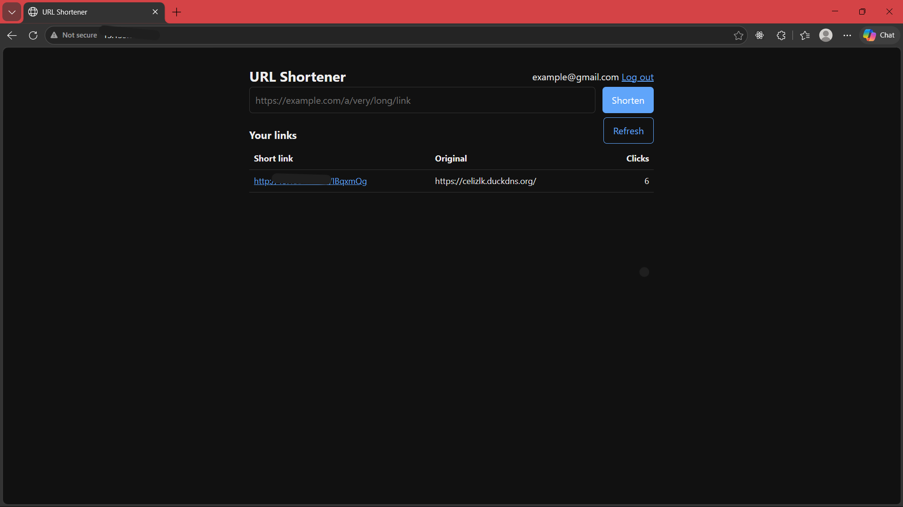
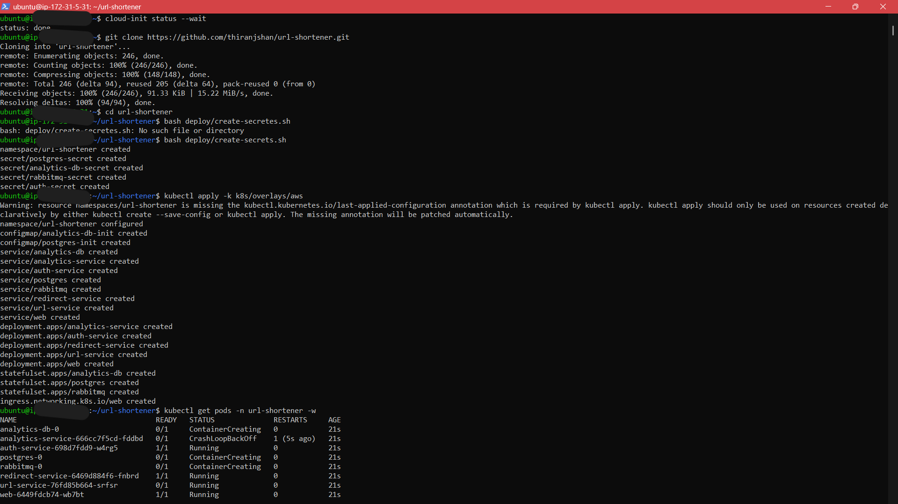
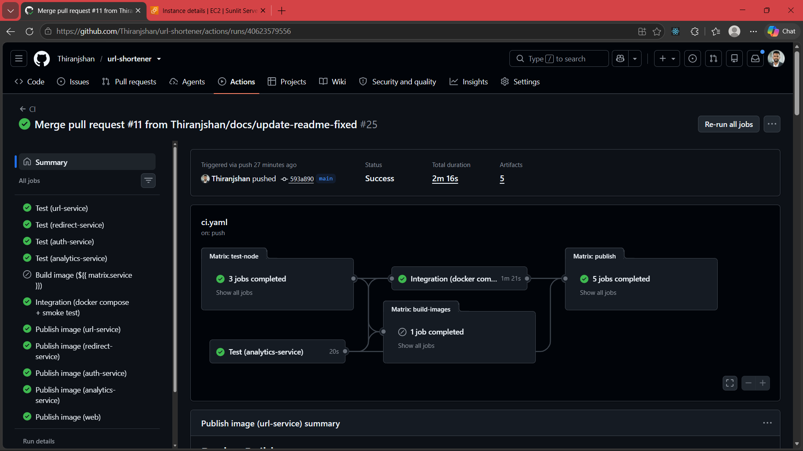
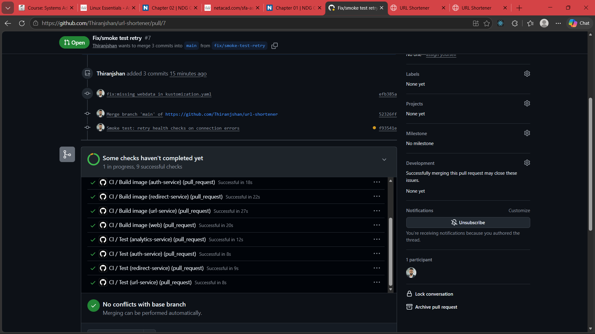
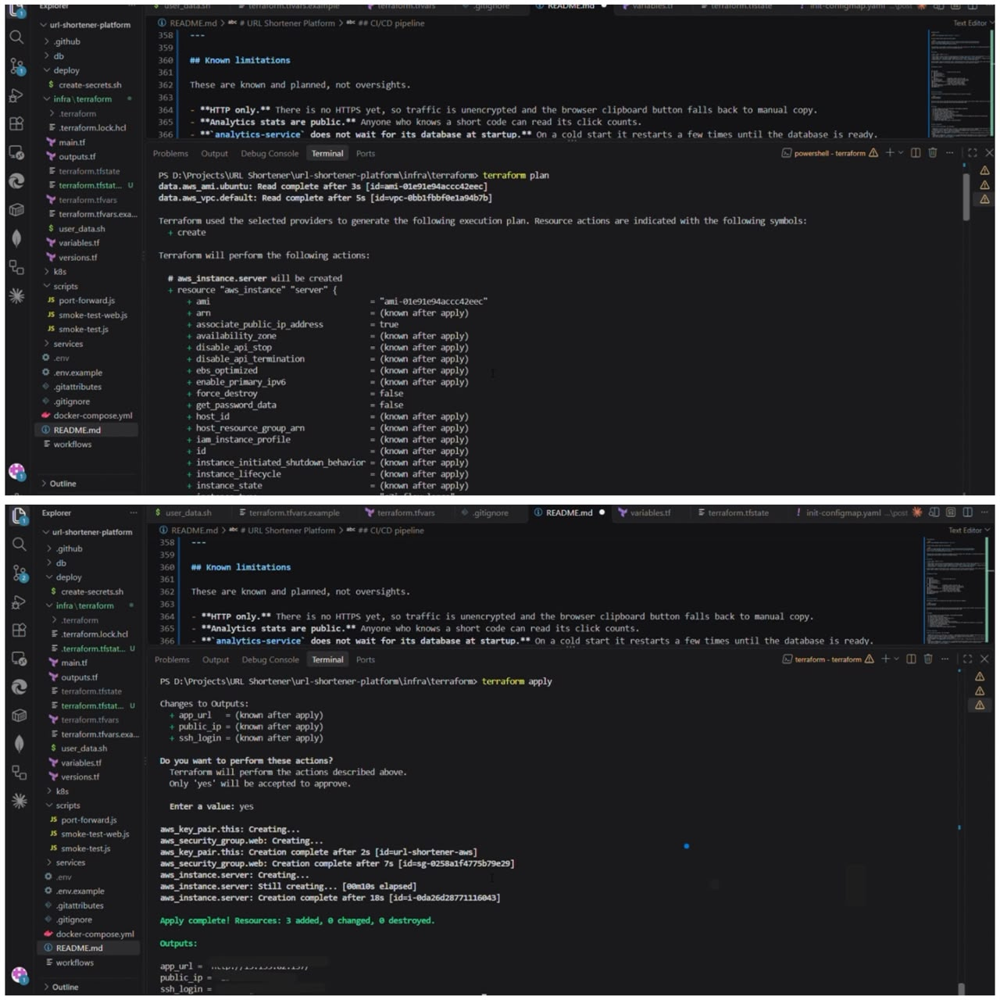
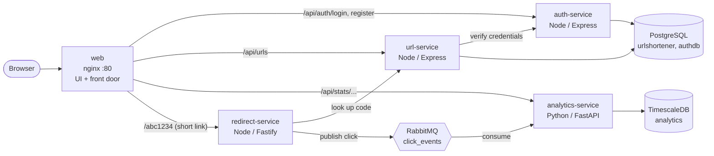
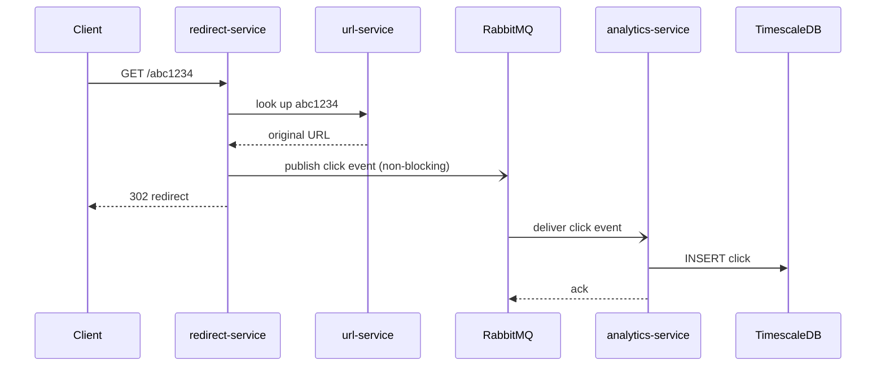
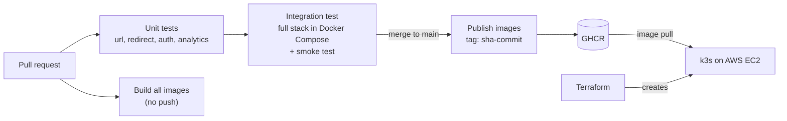

# URL Shortener Platform

[](https://github.com/Thiranjshan/url-shortener/actions/workflows/ci.yaml)

A URL shortener with real-time click analytics, built as a set of small services and shipped with a complete DevOps toolchain: containers, automated tests, a CI/CD pipeline, Kubernetes, and Terraform on AWS.

The application is deliberately simple. The project focuses on the engineering around it: service boundaries, testing, packaging, deployment, and recovery.

**Status:** runs locally (Docker Compose and Kubernetes) and on AWS (k3s on one EC2 server created by Terraform). Dashboards, load testing, HTTPS and GitOps are next. See the [Roadmap](#roadmap).

---

## Screenshots

|  |  |
| ------------------------------------------------------ | ------------------------------------------------------ |
| The app running on AWS                                 | Services running on the k3s server                     |
|  |  |
| Successful workflow summary                            | Unit tests, image builds, and integration checks       |



Terraform plan and apply

---

## Table of contents

- [Architecture](#architecture)
- [Services](#services)
- [CI/CD pipeline](#cicd-pipeline)
- [Tech stack](#tech-stack)
- [Running it](#running-it)
- [API](#api)
- [Design decisions](#design-decisions)
- [Failure and recovery demos](#failure-and-recovery-demos)
- [Testing](#testing)
- [Repository layout](#repository-layout)
- [Cost and teardown](#cost-and-teardown)
- [Roadmap](#roadmap)
- [Known limitations](#known-limitations)
- [What went wrong and what it taught me](#what-went-wrong-and-what-it-taught-me)

---

## Architecture

A single nginx container is the front door. It serves the UI and routes API calls and short links to the right service. Only the endpoints the page needs are exposed; internal ones such as credential verification are unreachable from outside.



### What happens on a click

The redirect is the hot path, so it does as little as possible. Recording the click is asynchronous: a slow or broken analytics pipeline can never delay or break a redirect.



---

## Services

| Service             | Stack                    | Responsibility                                             | Data                        |
| ------------------- | ------------------------ | ---------------------------------------------------------- | --------------------------- |
| `web`               | nginx, plain HTML/CSS/JS | UI and the single public entry point                       | none                        |
| `url-service`       | Node.js, Express         | Create and list short links (authenticated), resolve codes | PostgreSQL (`urlshortener`) |
| `redirect-service`  | Node.js, Fastify         | Public redirect, emits one click event per redirect        | none (stateless)            |
| `auth-service`      | Node.js, Express         | Registration, JWT login, API keys, credential verification | PostgreSQL (`authdb`)       |
| `analytics-service` | Python, FastAPI          | Consumes click events, stores and aggregates them          | TimescaleDB                 |

Supporting infrastructure: PostgreSQL 16, TimescaleDB, RabbitMQ.

Each service owns its data. No service reads another service's tables. `url-service` stores a `user_id` as a plain reference, with no cross-database foreign key.

---

## CI/CD pipeline

Every pull request and push to `main` runs the service tests and full-stack integration test. Pull requests also build images without pushing them; pushes to `main` publish images only after the checks pass.



- **Unit tests** run per service in parallel (Node's built-in test runner and pytest) with no database, network, or Docker. Dependencies are injected, so tests use small fakes.
- **Integration job** starts the whole stack with Docker Compose on a clean runner and runs an end-to-end smoke test. It catches wiring and configuration bugs that unit tests structurally cannot see.
- **Publish job** runs only on `main`, only after tests and integration pass. It pushes one image per service, tagged with the commit SHA. Tags are immutable, so every deployment can say exactly which commit it runs.
- **Least privilege:** the workflow is read-only by default. Only the publish job gets permission to write packages, using a short-lived token. No registry passwords are stored anywhere.

---

## Tech stack

| Area                   | Technology                                                 |
| ---------------------- | ---------------------------------------------------------- |
| Services               | Node.js 22 (Express, Fastify), Python 3.13 (FastAPI)       |
| Data and messaging     | PostgreSQL 16, TimescaleDB, RabbitMQ                       |
| Front door             | nginx                                                      |
| Containers             | Docker, Docker Compose                                     |
| Orchestration          | Kubernetes (Docker Desktop locally, k3s on AWS), Kustomize |
| Infrastructure as code | Terraform (AWS provider)                                   |
| Cloud                  | AWS EC2, security groups                                   |
| CI/CD                  | GitHub Actions, GitHub Container Registry (GHCR)           |
| Testing                | `node --test`, pytest, end-to-end smoke tests              |

---

## Running it

### 1. Locally with Docker Compose

Prerequisites: Docker Desktop, Node.js 18+, Git.

```bash
git clone https://github.com/Thiranjshan/url-shortener.git
cd url-shortener

# Create .env with a random JWT secret (works on Windows, macOS and Linux)
node -e "require('fs').writeFileSync('.env', 'JWT_SECRET=' + require('crypto').randomBytes(32).toString('hex') + '\n')"

docker compose up --build -d
node scripts/smoke-test.js
```

Open **http://localhost:8080**, create an account, shorten a link, click it, and press Refresh to see the click count.

`docker compose down` stops it; add `-v` to also delete the data.

### 2. On a local Kubernetes cluster

Requires a cluster (for example Docker Desktop with Kubernetes enabled) and `kubectl`. The images are pulled from GHCR, so nothing needs to be built locally.

```bash
bash deploy/create-secrets.sh      # random secrets, created only in the cluster
kubectl apply -k k8s/base
node scripts/port-forward.js       # leave running; forwards the services to localhost
node scripts/smoke-test.js         # in a second terminal
```

The image tags are pinned in `k8s/base/kustomization.yaml`. A release is a one-line change to those tags.

### 3. On AWS

Terraform creates one server with a firewall that allows SSH from a single address and HTTP from anywhere, then installs k3s on first boot.

```bash
cd infra/terraform
cp terraform.tfvars.example terraform.tfvars    # then edit: instance type, your IP
terraform init
terraform plan
terraform apply
```

Then log in to the server and deploy the app with the AWS overlay, which adds an Ingress so traffic from the internet reaches the front door:

```bash
git clone https://github.com/Thiranjshan/url-shortener.git
cd url-shortener
bash deploy/create-secrets.sh
kubectl apply -k k8s/overlays/aws
kubectl get pods -n url-shortener
```

Check it from outside, using only the public address:

```bash
WEB=http://<server-ip> node scripts/smoke-test-web.js
```

---

## API

Everything the UI needs is available through the front door:

| Method | Path                 | Auth | Description                                            |
| ------ | -------------------- | ---- | ------------------------------------------------------ |
| POST   | `/api/auth/register` | none | Create an account (`email`, `password`, 8+ characters) |
| POST   | `/api/auth/login`    | none | Returns a JWT valid for one hour                       |
| POST   | `/api/urls`          | JWT  | Create a short link (`url`, must be http or https)     |
| GET    | `/api/urls`          | JWT  | List your 20 most recent links                         |
| GET    | `/api/stats/{code}`  | none | Total clicks, clicks per hour, top referers            |
| GET    | `/{code}`            | none | `302` redirect to the original URL                     |

In Docker Compose each service also listens on its own port (url 3000, redirect 3001, auth 3002, analytics 8000). The auth service additionally supports API keys (`/api-keys`) and an internal `/verify` endpoint used by other services. Those are intentionally not exposed through the front door.

---

## Design decisions

**Database per service.** Each service owns its data and exposes it only through its API. Services stay independently deployable. The cost is that cross-service questions become API calls.

**Asynchronous analytics.** The redirect service publishes a click event and moves on. A redirect never waits for analytics, so analytics outages cannot affect redirects. Events accumulate in a durable queue and are processed when the consumer returns.

**At-least-once delivery.** The consumer acknowledges a message only after the database insert succeeds. If the database is down, the message is requeued. The trade-off is that a message can occasionally be processed twice.

**HTTP 302, not 301.** Browsers cache 301 redirects permanently, so repeat clicks would never reach the server and would be invisible to analytics.

**Fail closed on authentication.** If `auth-service` is unreachable, creating links returns `503` rather than allowing unauthenticated writes. Redirects do not depend on auth, so existing links keep working.

**Passwords and API keys are hashed differently on purpose.** Passwords use bcrypt (slow, salted). API keys are long random strings, so a fast SHA-256 hash is secure and allows an indexed lookup. Only the hash is stored, and the full key is shown once.

**One front door, a short allow-list.** nginx routes by path and exposes only what the page needs. Internal endpoints such as `/verify` and `/api-keys` return 404 from outside, and the public smoke test checks that.

**Immutable image tags.** Images are tagged with the commit SHA, never deployed as `latest`. Any running version can be traced to a commit, and rolling back is a one-line change.

**Same image everywhere.** The image that passed CI is the image that runs in Compose, on the local cluster, and on AWS. Only environment variables and secrets differ.

**Base and overlay.** Kubernetes manifests live once in `k8s/base`. The AWS overlay adds only what differs (the Ingress), with no copied YAML.

**Secrets are random per environment.** `deploy/create-secrets.sh` generates them inside the cluster and never overwrites an existing secret, since replacing a database password would lock the app out of its own data. Nothing sensitive is committed.

**Disposable infrastructure.** The whole AWS environment is created and destroyed from code. Data is intentionally ephemeral.

---

## Failure and recovery demos

Each of these is reproducible and shows a failure staying contained.

**Analytics down, redirects unaffected, nothing lost** (Docker Compose)

```bash
docker compose stop analytics-service
curl -i http://localhost:3001/<code>                         # still 302
docker exec rabbitmq rabbitmqctl list_queues name messages   # click events are waiting
docker compose start analytics-service                       # backlog is processed
```

**Kubernetes self-healing**

```bash
kubectl delete pod -l app=url-service      # a replacement starts within seconds
```

**Scaling out**

```bash
kubectl scale deployment redirect-service --replicas=3
```

**A bad release cannot take the service down**

```bash
kubectl set image deployment/redirect-service redirect-service=redirect-service:doesnotexist
# The new pod never becomes ready, so it never receives traffic; the old pod keeps serving.
kubectl rollout undo deployment/redirect-service
```

**Persistence is not backup.** Deleting a database pod loses nothing, but `DROP TABLE` is preserved faithfully by the volume too. A manual `pg_dump` and restore drill is part of the project history.

---

## Testing

| Level             | What                                                                                         | Where it runs              |
| ----------------- | -------------------------------------------------------------------------------------------- | -------------------------- |
| Unit              | Logic of each service with injected fakes: validation, auth rules, hashing, failure handling | CI, every push             |
| Integration       | The full stack in Docker Compose plus `scripts/smoke-test.js`                                | CI, every push             |
| Public smoke test | Black-box checks through the front door only: `scripts/smoke-test-web.js`                    | Against the AWS server     |
| Infrastructure    | `terraform validate` and `terraform plan`                                                    | Locally before every apply |

Several design claims are enforced by tests: authentication fails closed, plaintext API keys never reach the database, a failing queue publisher cannot break a redirect, and unknown emails and wrong passwords return identical responses.

---

## Repository layout

```
.
├── services/
│   ├── web/                  # nginx front door and UI
│   ├── url-service/
│   ├── redirect-service/
│   ├── auth-service/
│   └── analytics-service/
├── k8s/
│   ├── base/                 # databases, broker, services, web
│   └── overlays/aws/         # adds the Ingress used on the AWS server
├── infra/terraform/          # AWS firewall, EC2 server, k3s bootstrap
├── deploy/create-secrets.sh  # generates random cluster secrets
├── db/                       # init SQL used by Docker Compose
├── scripts/                  # smoke tests, port-forward helper
├── .github/workflows/ci.yaml # tests, integration, build, publish
├── docker-compose.yml
└── ROADMAP.md
```

---

## Cost and teardown

Everything on AWS can be removed with one command, which stops all spending:

```bash
cd infra/terraform
terraform destroy
```

The project was built on the AWS Free plan using a single x86 instance with 4 GiB of memory. With the full stack running, the node used about 1.6 GiB of 3.7 GiB, and the application pods about 350 MiB between them.

---

## Roadmap

- [x] Four backend services with PostgreSQL, TimescaleDB and RabbitMQ
- [x] Docker Compose environment
- [x] Kubernetes manifests with Kustomize
- [x] CI: unit tests, integration test, image builds
- [x] Immutable images published to GHCR
- [x] Minimal UI behind an nginx front door
- [x] AWS deployment: Terraform-created server running k3s
- [ ] Automate the app deployment inside the Terraform bootstrap (one command from nothing to a running app)
- [ ] Prometheus and Grafana dashboards
- [ ] k6 load tests, with published results
- [ ] HTTPS and a domain name
- [ ] GitOps with ArgoCD and automatic image-tag updates

---

## Known limitations

- **HTTP only.** There is no HTTPS yet, so traffic is unencrypted and the browser clipboard button falls back to manual copy.
- **Analytics stats are public.** Anyone who knows a short code can read its click counts.
- **`analytics-service` does not wait for its database at startup.** On a cold start it restarts a few times until the database is ready. Kubernetes handles this, but it should retry politely.
- **The consumer is not idempotent**, and there is no dead-letter queue. A redelivered message could be counted twice, and malformed events are dropped.
- **Clicks are skipped while `redirect-service` is disconnected from the broker.** That is the price of never blocking a redirect.
- **The token is stored in `localStorage`.** Acceptable for a demo; production would use httpOnly cookies.
- **No rate limiting** on public endpoints.
- **No monitoring or alerting yet.**
- **Secrets are created by a script on the server**, not managed by a secrets service.
- **Python dependencies are not pinned**, unlike the Node services, which use lockfiles.

---

## What went wrong and what it taught me

- **A flaky integration test.** The smoke test sometimes failed because the first click could arrive before the redirect service had connected to RabbitMQ. Clicks in that window are skipped by design, so the test now allows for that instead of relying on a blind sleep.
- **A bug that only the integration job could catch.** I pointed `url-service` at the wrong auth port on purpose. All unit tests stayed green and the integration job failed. The failure showed why both unit and integration tests are needed.
- **A merge with a red pipeline.** A pull request was merged while the integration job was failing, so the publish step never ran and the image I needed did not exist. Branch protection that requires checks would have prevented it.
- **A cloud guardrail.** An organization-level policy on the AWS account blocked one API call, regardless of IAM permissions. Reading the "explicit deny in a service control policy" message correctly saved a lot of time.
- **Windows line endings.** A shell script written on Windows would have failed on Linux. A `.gitattributes` rule and a guard in Terraform now prevent it.
- **Ping is not a health check.** The server answered on port 80 locally but not from the internet, and ICMP was blocked by design. Testing the actual port and inspecting the firewall rules found the problem.
