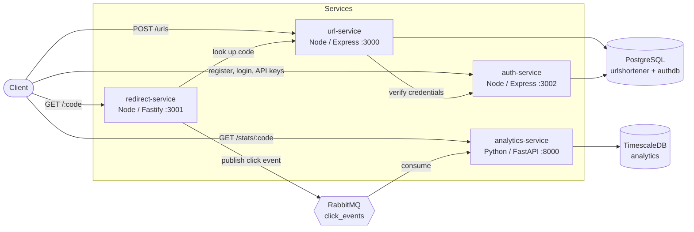
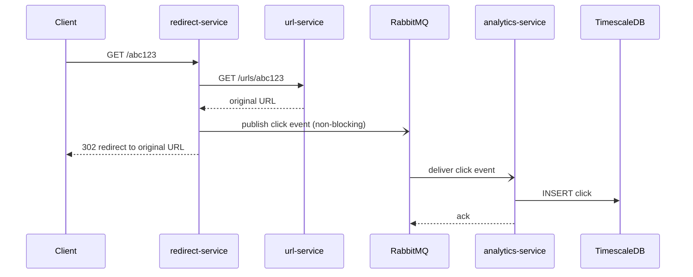

# URL Shortener Platform

A URL shortener with real-time click analytics, built as independent microservices. The application is intentionally simple. The point of the project is the engineering around it: service boundaries, asynchronous messaging, failure isolation, reproducible environments, and (in later phases) Kubernetes, Infrastructure as Code, CI/CD, GitOps and observability.

**Status:** Phase 1 complete (all services working locally with Docker Compose). Phase 2 (Kubernetes) is next. See the [Roadmap](#roadmap).

---

## Table of contents

- [Architecture](#architecture)
- [Services](#services)
- [Tech stack](#tech-stack)
- [Getting started](#getting-started)
- [API reference](#api-reference)
- [Design decisions](#design-decisions)
- [Resilience demos](#resilience-demos)
- [Testing](#testing)
- [Repository layout](#repository-layout)
- [Roadmap](#roadmap)
- [Known limitations](#known-limitations)

---

## Architecture



### The redirect path

The redirect is the hot path, so it does as little as possible. Analytics is handled asynchronously, which means a slow or unavailable analytics pipeline can never delay or break a redirect.



---

## Services

| Service             | Stack            | Port | Responsibility                                             | Data store                  |
| ------------------- | ---------------- | ---- | ---------------------------------------------------------- | --------------------------- |
| `url-service`       | Node.js, Express | 3000 | Creates short URLs (authenticated) and resolves codes      | PostgreSQL (`urlshortener`) |
| `redirect-service`  | Node.js, Fastify | 3001 | Public redirect endpoint; emits a click event per redirect | None (stateless)            |
| `auth-service`      | Node.js, Express | 3002 | Users, JWT login, API keys, credential verification        | PostgreSQL (`authdb`)       |
| `analytics-service` | Python, FastAPI  | 8000 | Consumes click events, stores and aggregates them          | TimescaleDB (`analytics`)   |

Supporting infrastructure: **PostgreSQL 16**, **TimescaleDB** (PostgreSQL 16), **RabbitMQ 3** (with management UI on port 15672).

Each service owns its own data. No service reads another service's tables. `url-service` stores a `user_id` as a plain reference, with no cross-database foreign key.

---

## Tech stack

| Area                    | Technology                                         | Status  |
| ----------------------- | -------------------------------------------------- | ------- |
| Services                | Node.js 22, Express, Fastify, Python 3.13, FastAPI | Done    |
| Data                    | PostgreSQL 16, TimescaleDB                         | Done    |
| Messaging               | RabbitMQ                                           | Done    |
| Containers              | Docker, Docker Compose                             | Done    |
| Orchestration           | Kubernetes (local first, then k3s on AWS EC2)      | Phase 2 |
| Infrastructure as Code  | Terraform                                          | Phase 2 |
| CI                      | GitHub Actions                                     | Phase 3 |
| CD / GitOps             | ArgoCD, GHCR                                       | Phase 3 |
| Observability           | Prometheus, Grafana, Loki                          | Phase 4 |
| Caching and autoscaling | Redis, Horizontal Pod Autoscaler                   | Phase 5 |
| Load testing            | k6                                                 | Phase 5 |

---

## Getting started

### Prerequisites

- Docker Desktop (with Docker Compose v2)
- Node.js 18+ (only needed for the secret generator and the smoke test)
- Git

### 1. Clone and create your environment file

```bash
git clone <your-repo-url>
cd url-shortener-platform
```

Create a `.env` file with a random JWT secret. This one command works on Windows, macOS and Linux:

```bash
node -e "require('fs').writeFileSync('.env', 'JWT_SECRET=' + require('crypto').randomBytes(32).toString('hex') + '\n')"
```

`.env` is git-ignored. `.env.example` shows the expected variables.

### 2. Start everything

```bash
docker compose up --build
```

On the first start, Postgres and TimescaleDB run the scripts in `db/` automatically to create the schemas. Wait until you see `auth-service listening on port 3002` and `consuming from queue 'click_events'` in the logs.

### 3. Verify it works

```bash
node scripts/smoke-test.js
```

Expected result: every line `PASS`, ending with `All checks passed`.

### Useful URLs

| What                         | URL                                                              |
| ---------------------------- | ---------------------------------------------------------------- |
| Redirect (public)            | http://localhost:3001/`<code>`                                   |
| url-service                  | http://localhost:3000                                            |
| auth-service                 | http://localhost:3002                                            |
| Analytics API docs (Swagger) | http://localhost:8000/docs                                       |
| RabbitMQ management UI       | http://localhost:15672 (dev credentials in `docker-compose.yml`) |

### Resetting

```bash
docker compose down        # stop, keep data
docker compose down -v     # stop and delete all data (re-runs the db/ init scripts on next start)
```

---

## API reference

Examples use bash syntax. On Windows Command Prompt, escape the JSON quotes (`-d "{\"url\": \"https://example.com\"}"`).

### auth-service (:3002)

| Method | Path            | Auth           | Description                                                                                       |
| ------ | --------------- | -------------- | ------------------------------------------------------------------------------------------------- |
| POST   | `/register`     | None           | Create a user. Body: `{ "email", "password" }` (min 8 chars). `201`, or `409` if the email exists |
| POST   | `/login`        | None           | Returns `{ "token" }` (JWT, 1 hour). `401` on bad credentials                                     |
| POST   | `/api-keys`     | Bearer JWT     | Creates an API key. The full key is returned **once**                                             |
| GET    | `/api-keys`     | Bearer JWT     | Lists your keys (prefix and metadata only)                                                        |
| DELETE | `/api-keys/:id` | Bearer JWT     | Revokes a key. `204`                                                                              |
| GET    | `/verify`       | JWT or API key | Internal. Validates credentials for other services                                                |
| GET    | `/health`       | None           | Liveness check                                                                                    |

```bash
curl -X POST http://localhost:3002/register \
  -H "Content-Type: application/json" \
  -d '{"email": "me@example.com", "password": "a-long-password"}'

curl -X POST http://localhost:3002/login \
  -H "Content-Type: application/json" \
  -d '{"email": "me@example.com", "password": "a-long-password"}'
```

### url-service (:3000)

| Method | Path               | Auth                          | Description                                                                                         |
| ------ | ------------------ | ----------------------------- | --------------------------------------------------------------------------------------------------- |
| POST   | `/urls`            | Bearer JWT **or** `X-API-Key` | Creates a short URL. Body: `{ "url" }`. `201`, `400` (invalid URL), `401`, `503` (auth unavailable) |
| GET    | `/urls/:shortCode` | None (internal)               | Returns the original URL. Used by redirect-service. `404` if unknown                                |
| GET    | `/health`          | None                          | Liveness check                                                                                      |

```bash
curl -X POST http://localhost:3000/urls \
  -H "Authorization: Bearer $TOKEN" \
  -H "Content-Type: application/json" \
  -d '{"url": "https://example.com/some/long/path"}'
# or: -H "X-API-Key: sk_..."
```

### redirect-service (:3001)

| Method | Path          | Auth | Description                                                                      |
| ------ | ------------- | ---- | -------------------------------------------------------------------------------- |
| GET    | `/:shortCode` | None | `302` to the original URL. `404` if unknown, `502` if url-service is unreachable |
| GET    | `/health`     | None | Liveness check                                                                   |

### analytics-service (:8000)

| Method | Path                         | Description                                                      |
| ------ | ---------------------------- | ---------------------------------------------------------------- |
| GET    | `/stats/:shortCode?hours=24` | Total clicks, clicks per hour for the last N hours, top referers |
| GET    | `/health`                    | Liveness check                                                   |
| GET    | `/docs`                      | Interactive OpenAPI documentation                                |

---

## Design decisions

These are the choices that shape the system, with the reasoning and trade-offs.

**Microservices with database-per-service.** Each service owns its data and exposes it only through its API. This keeps services independently deployable and replaceable. The cost is that cross-service queries become API calls, which is why `url-service` stores a plain `user_id` instead of a foreign key.

**Asynchronous analytics through a message queue.** The redirect service publishes a click event and moves on. A redirect never waits for analytics, so analytics outages can't affect redirects. Events accumulate in a durable queue and are processed when the consumer returns.

**At-least-once delivery.** The analytics consumer acknowledges a message only after the database insert succeeds. If the database is down, the message is requeued. The trade-off is that a message can occasionally be processed twice. Making the consumer idempotent is listed under [Known limitations](#known-limitations).

**HTTP 302, not 301.** Browsers cache 301 redirects permanently, so repeat clicks would never reach the server and would be invisible to analytics.

**Fail closed on authentication.** If `auth-service` is unreachable, `POST /urls` returns `503` instead of allowing unauthenticated writes. Redirects don't depend on auth, so existing links keep working during an auth outage.

**Passwords and API keys are hashed differently on purpose.** Passwords use bcrypt, which is deliberately slow and salted. API keys are long random strings, so a fast SHA-256 hash is secure and allows an indexed lookup by hash. Only the hash is stored. The full key is shown once at creation, and a short prefix is kept for display.

**TimescaleDB for click data.** Click events are time-series data. A hypertable partitions them by time automatically, and `time_bucket` makes "clicks per hour" queries simple and fast. It is still PostgreSQL, so the tooling is familiar.

**Twelve-factor configuration.** Every service reads its configuration from environment variables with local defaults. The same container image runs in Docker Compose now and in Kubernetes later, with only the injected values changing.

**Fail fast on missing secrets.** `auth-service` exits immediately if `JWT_SECRET` is not set, rather than running with an insecure default.

---

## Resilience demos

Each of these can be reproduced locally and demonstrates that a failure stays contained. Let `$CODE` be a valid short code.

**Analytics down, redirects unaffected, no data lost**

```bash
docker compose stop analytics-service
curl -i http://localhost:3001/$CODE          # still 302
docker exec rabbitmq rabbitmqctl list_queues name messages   # events are waiting
docker compose start analytics-service       # backlog is processed
curl http://localhost:8000/stats/$CODE       # totals include the missed clicks
```

**RabbitMQ down, redirects unaffected**

```bash
docker compose stop rabbitmq
curl -i http://localhost:3001/$CODE          # still 302 (click is skipped and a warning is logged)
docker compose start rabbitmq                # redirect-service reconnects automatically
```

**Auth down, existing links unaffected**

```bash
docker compose stop auth-service
curl -i -X POST http://localhost:3000/urls ...   # 503, creation refused
curl -i http://localhost:3001/$CODE              # still 302
docker compose start auth-service
```

---

## Testing

| Level                     | What                                                                                                                            | Status  |
| ------------------------- | ------------------------------------------------------------------------------------------------------------------------------- | ------- |
| End-to-end smoke test     | `scripts/smoke-test.js` exercises registration, login, API keys, authenticated creation, redirects and the async analytics path | Done    |
| Unit tests                | Per-service test suites                                                                                                         | Phase 3 |
| Integration tests in CI   | Docker Compose stack run in GitHub Actions                                                                                      | Phase 3 |
| Infrastructure validation | `terraform validate` and `terraform plan` in CI                                                                                 | Phase 3 |
| Load testing              | k6 against the deployed system                                                                                                  | Phase 5 |

The smoke test reads its service addresses from environment variables (`URL_SERVICE`, `REDIRECT_SERVICE`, `AUTH_SERVICE`, `ANALYTICS_SERVICE`), so the same script can later run against a Kubernetes or cloud deployment. It exits non-zero on any failure, which lets a pipeline gate on it.

---

## Repository layout

```
url-shortener-platform/
├── services/
│   ├── url-service/          # Node.js / Express
│   ├── redirect-service/     # Node.js / Fastify
│   ├── auth-service/         # Node.js / Express
│   └── analytics-service/    # Python / FastAPI
├── db/
│   ├── init.sql              # urlshortener schema
│   ├── auth-init.sql         # authdb database and schema
│   └── analytics-init.sql    # TimescaleDB hypertable
├── scripts/
│   └── smoke-test.js         # end-to-end test
├── docker-compose.yml
├── .env.example
└── README.md
```

Each service folder contains its own `Dockerfile` and dependency manifest, so it can be built and deployed independently.

---

## Roadmap

- [x] **Phase 1: Foundation.** Four services, Postgres, TimescaleDB, RabbitMQ, Docker Compose, smoke test
- [ ] **Phase 2: Orchestration and IaC.** Kubernetes manifests (local cluster first), Terraform for an AWS EC2 host running k3s
- [ ] **Phase 3: CI/CD.** GitHub Actions (test, build, push to GHCR), ArgoCD GitOps deployment
- [ ] **Phase 4: Observability.** Prometheus metrics, Grafana dashboards, Loki logs
- [ ] **Phase 5: Resilience and performance.** Redis cache for redirects, autoscaling, k6 load tests with published results
- [ ] **Phase 6: Polish.** Architecture write-up, demo recording, teardown and rebuild verification

---

## Known limitations

These are known and planned, not oversights.

- **Development credentials** are hardcoded in `docker-compose.yml` (database and RabbitMQ passwords). They will move to environment files locally and to Kubernetes Secrets in Phase 2.
- **The analytics consumer is not idempotent.** A redelivered message could be counted twice. A unique event ID would fix this.
- **No dead-letter queue.** Malformed events are logged and dropped. A DLQ would preserve them for inspection.
- **No rate limiting** on public endpoints yet.
- **`GET /urls/:shortCode` and `GET /verify` are unauthenticated** because they are internal endpoints. In Kubernetes they will not be exposed outside the cluster.
- **No automated unit tests yet.** They are added alongside CI in Phase 3.
- **Short codes use random IDs without a collision retry.** Collisions are very unlikely at this scale but not handled.
