# URL Shortener Platform

[](https://github.com/Thiranjshan/url-shortener/actions/workflows/ci.yaml)

A URL shortener with real-time click analytics, built to practise the full DevOps lifecycle end to end: containers, automated tests, a CI/CD pipeline, Kubernetes, Terraform on AWS, GitOps deployment, monitoring, load testing and HTTPS.

The application is deliberately simple. The engineering around it is the point: how the parts are separated, tested, packaged, deployed, observed and recovered when something fails.

**Live demo:** https://urlshortenapp.duckdns.org

> The live demo runs on a single AWS instance and may be turned off to limit cloud costs.

---

## Screenshots

|                                                                  |                                                                   |
| ---------------------------------------------------------------- | ----------------------------------------------------------------- |
| 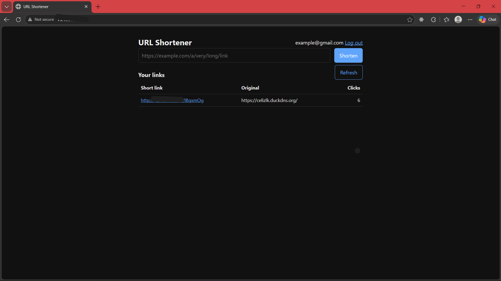          | 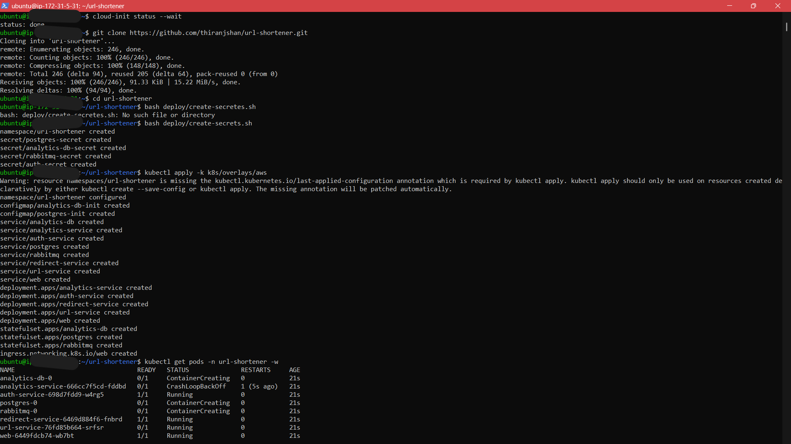           |
| The app running on AWS                                           | Services running on the k3s server                                |
| 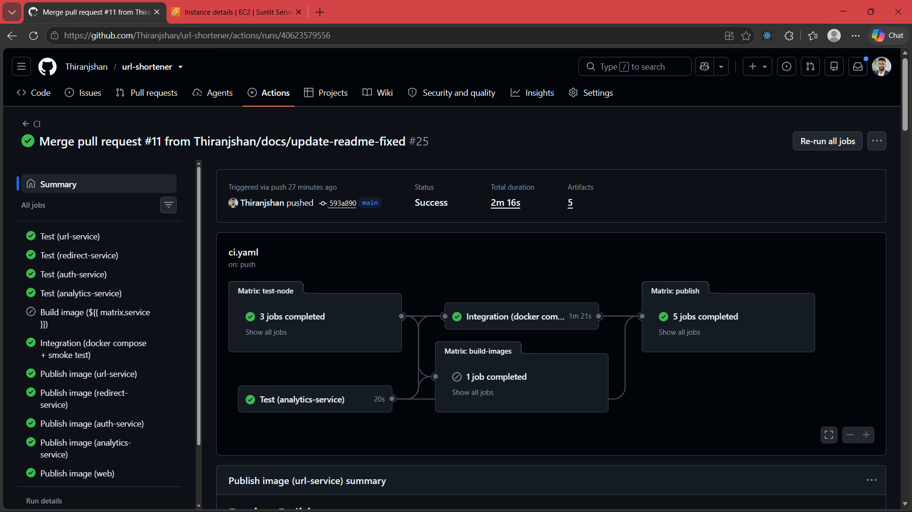     | 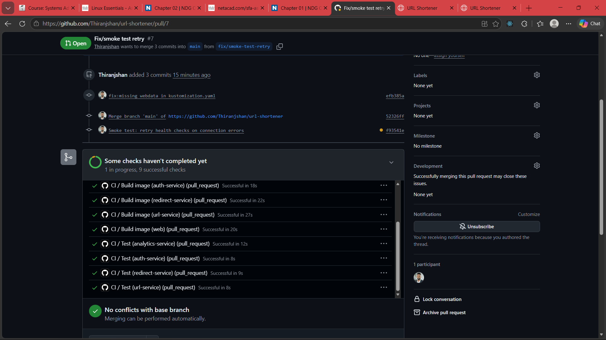         |
| Successful workflow summary                                      | Unit tests, image builds and integration checks                   |
| 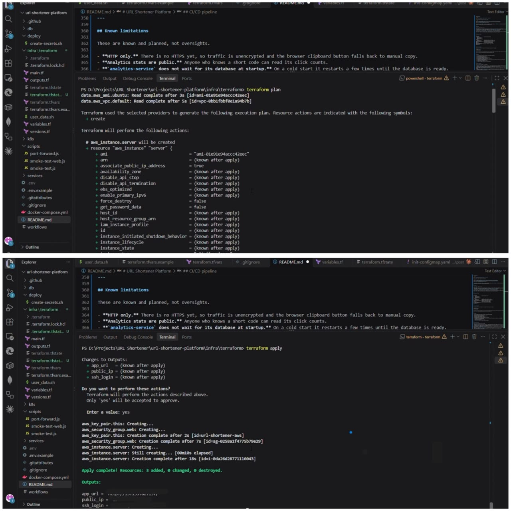          | 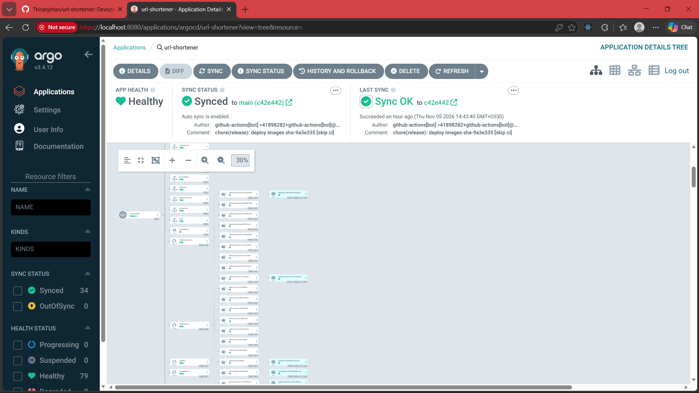 |
| Terraform creating the server from code                          | Argo CD showing the app Synced and Healthy                        |
| 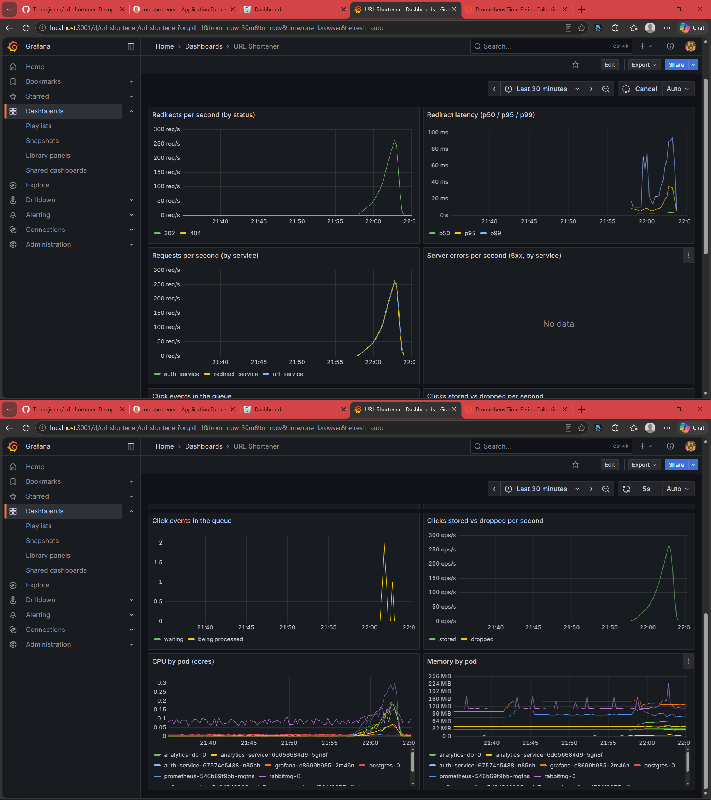         | 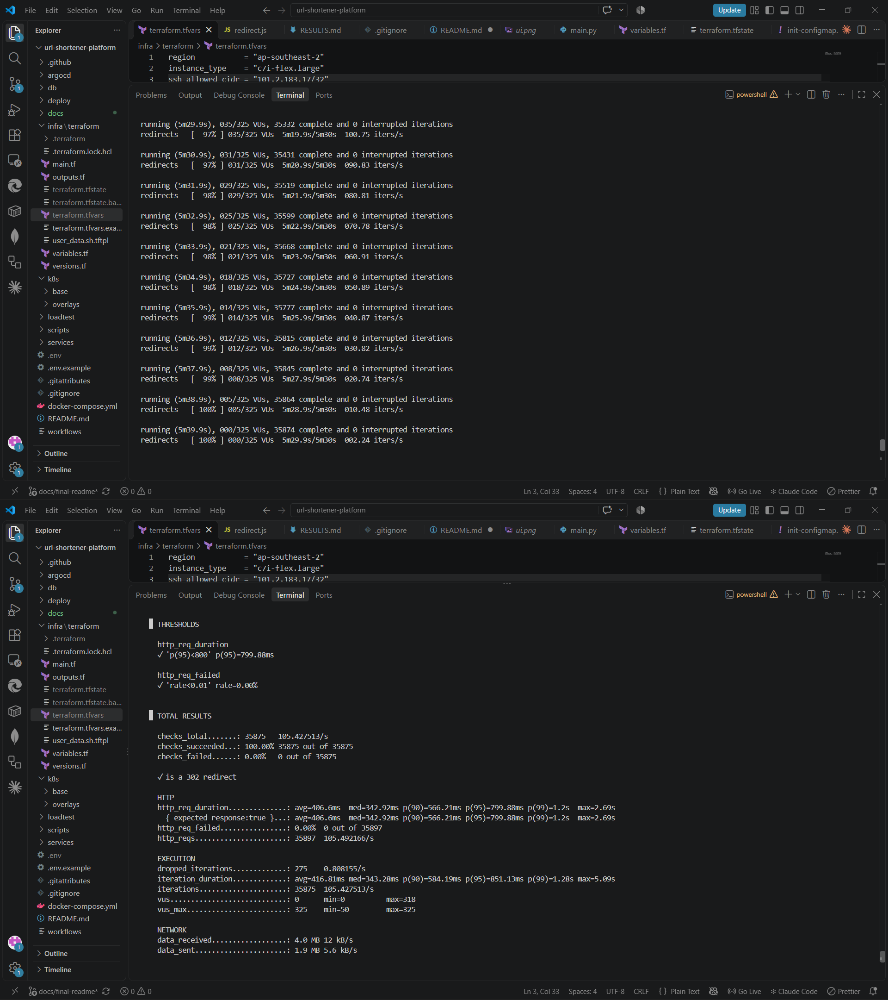                       |
| Grafana dashboard during the load test                           | k6 summary from the load test                                     |
| 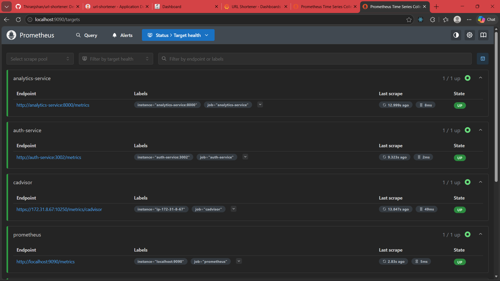 | 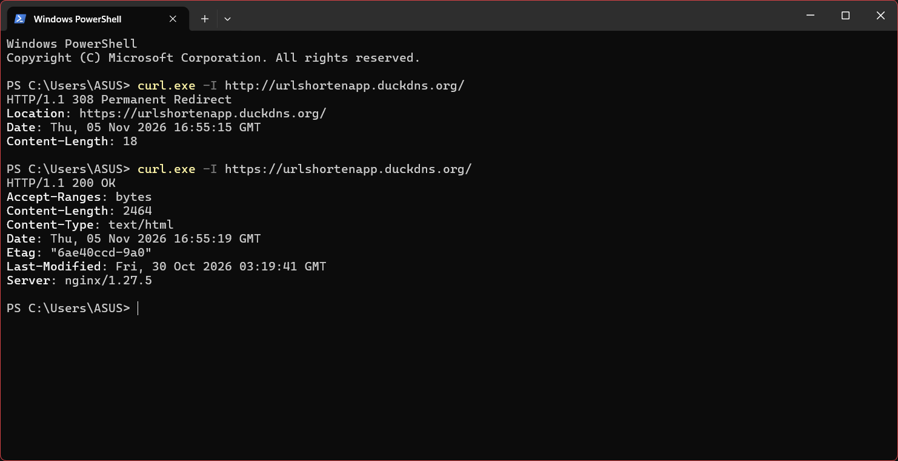          |
| Prometheus targets, all UP                                       | HTTPS with a valid certificate                                    |

---

## Contents

- [What it does](#what-it-does)
- [Architecture](#architecture)
- [How a change reaches production](#how-a-change-reaches-production)
- [Tech stack](#tech-stack)
- [Running it](#running-it)
- [API](#api)
- [Observability](#observability)
- [Load test](#load-test)
- [Design decisions](#design-decisions)
- [Failure and recovery](#failure-and-recovery)
- [Testing](#testing)
- [Repository layout](#repository-layout)
- [Cost and teardown](#cost-and-teardown)
- [Known limitations](#known-limitations)
- [Lessons learned](#lessons-learned)
- [Future work](#future-work)

---

## What it does

- Sign up and log in with email and password
- Shorten a long link and get a short one, such as `https://urlshortenapp.duckdns.org/abc1234`
- Open a short link, which redirects with `302` and records a click
- See your links with their click counts in a small web UI
- Create API keys for programmatic use

## Architecture

A single nginx container is the public front door. It serves the UI and routes API calls and short links to the right service. Only the endpoints the page needs are exposed. Internal endpoints, such as credential verification and metrics, return `404` from outside.

HTTPS terminates at Traefik, the ingress controller that ships with k3s. The certificate comes from Let's Encrypt and is renewed automatically by cert-manager. Traffic inside the cluster stays plain HTTP.

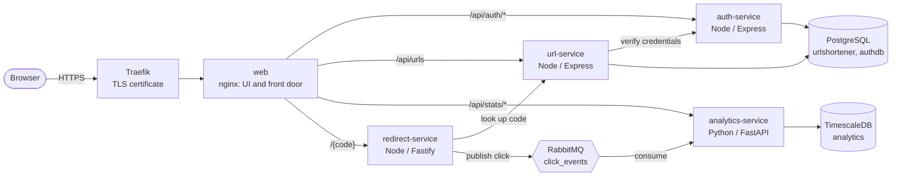

### What happens on a click

The redirect is the hot path, so it does as little work as possible. Recording the click is asynchronous: a slow or broken analytics pipeline can never delay or break a redirect.

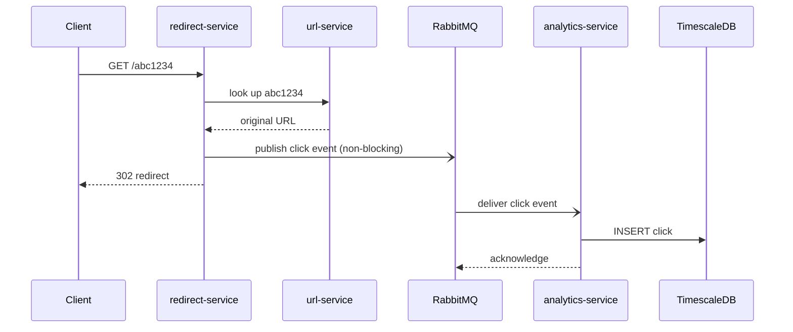

## How a change reaches production

Merging a pull request is the only deployment step. Nothing is copied to the server by hand.

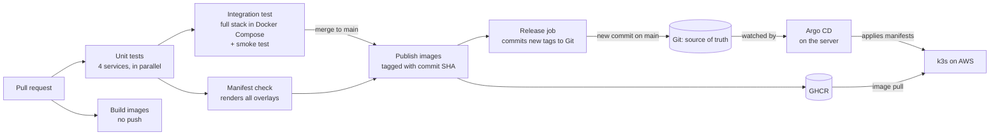

- **Continuous integration:** every change is tested before it can merge. A failing test blocks the merge, and a failing integration test blocks publishing.
- **Continuous delivery:** each passing change becomes immutable, versioned images, tagged with the commit they came from.
- **Continuous deployment:** the release job records the new tags in Git, and Argo CD, which runs inside the cluster and pulls from Git, applies them. The server never needs credentials from GitHub, and GitHub never needs the server's address.
- **Loop protection:** the release commit is pushed with the built-in token, which does not trigger new workflows, and its message carries `[skip ci]` as a second guard.
- **Docs-only changes** (Markdown, `docs/`, `loadtest/`) skip the pipeline, so they never redeploy anything.

## Tech stack

| Area                   | Technology                                                                               |
| ---------------------- | ---------------------------------------------------------------------------------------- |
| Services               | Node.js 22 (Express, Fastify), Python 3.13 (FastAPI)                                     |
| Data and messaging     | PostgreSQL 16, TimescaleDB, RabbitMQ 3                                                   |
| Front door and UI      | nginx, plain HTML, CSS and JavaScript (no framework)                                     |
| Containers             | Docker, Docker Compose                                                                   |
| Orchestration          | Kubernetes: Docker Desktop locally, k3s on AWS. Kustomize with a base and an AWS overlay |
| Infrastructure as code | Terraform with the AWS provider                                                          |
| Cloud                  | AWS EC2 (x86, 4 GiB), security groups, IAM                                               |
| CI/CD                  | GitHub Actions, GitHub Container Registry, Argo CD (GitOps)                              |
| Certificates           | cert-manager with Let's Encrypt, Traefik ingress                                         |
| Observability          | Prometheus, Grafana (dashboard as code), RED metrics                                     |
| Load testing           | k6                                                                                       |
| Testing                | Node's built-in test runner, pytest, end-to-end smoke tests                              |

## Running it

### Locally with Docker Compose

Prerequisites: Docker Desktop, Node.js 18+, Git.

```bash
git clone https://github.com/Thiranjshan/url-shortener.git
cd url-shortener

# Create .env with a random JWT secret (works on Windows, macOS and Linux)
node -e "require('fs').writeFileSync('.env', 'JWT_SECRET=' + require('crypto').randomBytes(32).toString('hex') + '\n')"

docker compose up --build -d
node scripts/smoke-test.js
```

Open http://localhost:8080, create an account, shorten a link, open it, and press Refresh to see the click count.

`docker compose down` stops everything. Add `-v` to also delete the data.

### On a local Kubernetes cluster

Requires a cluster, such as Docker Desktop with Kubernetes enabled, and `kubectl`. The images come from GHCR, so nothing is built locally.

```bash
bash deploy/create-secrets.sh      # random secrets, created only inside the cluster
kubectl apply -k k8s/base
node scripts/port-forward.js       # leave running
node scripts/smoke-test.js         # in a second terminal
```

### On AWS

Terraform creates the server, and the server deploys itself:

```bash
cd infra/terraform
cp terraform.tfvars.example terraform.tfvars   # set the instance type and your IP
terraform init
terraform apply
```

On first boot, the server clones this repository and runs `deploy/bootstrap.sh`. That script installs k3s, creates the secrets, installs Argo CD, and hands the application to it. A rebuild from nothing takes about **5 minutes**, measured end to end with `terraform apply` followed by the public smoke test.

A rebuilt server has a new IP address, so update it on DuckDNS afterwards. Certificates are issued automatically once the domain points at the server.

Check the live deployment from outside, using only the public address:

```bash
WEB=https://urlshortenapp.duckdns.org node scripts/smoke-test-web.js
```

## API

Everything the UI uses is available through the front door:

| Method | Path                 | Auth           | Description                                              |
| ------ | -------------------- | -------------- | -------------------------------------------------------- |
| POST   | `/api/auth/register` | none           | Create an account (`email`, `password` of 8+ characters) |
| POST   | `/api/auth/login`    | none           | Returns a JWT valid for one hour                         |
| POST   | `/api/urls`          | JWT or API key | Create a short link (`url` must be http or https)        |
| GET    | `/api/urls`          | JWT or API key | List your 20 most recent links                           |
| GET    | `/api/stats/{code}`  | none           | Total clicks, clicks per hour, top referers              |
| GET    | `/{code}`            | none           | `302` redirect to the original URL                       |

Authenticate with `Authorization: Bearer <token>` or `X-API-Key: <key>`. The auth service also issues API keys, and it has an internal credential check that other services use. Neither is reachable through the front door.

## Observability

Every service exposes Prometheus metrics at `/metrics`, labelled by route pattern rather than raw URL, so the number of time series stays bounded. Prometheus scrapes every 15 seconds. It also collects RabbitMQ queue depth and per-pod CPU and memory from the kubelet.

The Grafana dashboard **URL Shortener** is stored as JSON in the repository, so every rebuild recreates it. It shows:

- Service status (UP or DOWN) for every target
- Redirects per second, split by status code
- Redirect latency at p50, p95 and p99
- Requests and server errors per second, by service
- Click events waiting and being processed in the queue
- Clicks stored versus dropped
- CPU and memory per pod

Prometheus and Grafana are never exposed to the internet. They are reached through an SSH tunnel.

## Load test

The load test drives redirects only, stepping the request rate from 25 to 300 requests per second, one minute per step. It runs from a laptop against the public address, using k6 with an arrival-rate model, so it keeps sending at the set rate even when the server slows down.

The full results are in [`loadtest/RESULTS.md`](loadtest/RESULTS.md). They include the highest rate sustained with errors under 1%, client and server latency percentiles, the error rate, and whether every redirect became a stored click. The script is in [`loadtest/redirect.js`](loadtest/redirect.js).

Every redirect performs a database lookup, because there is no cache yet. Adding one is the obvious next experiment.

## Design decisions

**Database per service.** Each service owns its data and exposes it only through its API. Services stay independently deployable. The cost is that cross-service questions become API calls.

**Asynchronous analytics.** A redirect publishes a click event and moves on. Analytics outages cannot affect redirects, and events wait in a durable queue until the consumer is ready.

**At-least-once delivery.** The consumer acknowledges a message only after the database write succeeds. The trade-off is that a message can occasionally be processed twice.

**HTTP 302, not 301.** Browsers cache a 301 permanently, so repeat visits would skip the server and disappear from analytics.

**Fail closed on authentication.** If the auth service is unreachable, creating links returns `503` rather than allowing unauthenticated writes. Redirects do not depend on auth.

**Passwords and API keys hashed differently.** Passwords use bcrypt, which is slow and salted. API keys are long random strings, so a fast SHA-256 hash is sufficient and allows an indexed lookup. Only the hash is stored, and the full key is shown once.

**One front door, a short allow-list.** nginx exposes only what the page needs. A test checks that internal endpoints return `404` from outside, so a regression would fail the public smoke test.

**Immutable, traceable images.** Images are tagged with the commit SHA and never deployed as `latest`. Any running version maps to one commit, and rolling back means changing one tag.

**Same image everywhere.** The image that passed CI runs in Compose, on the local cluster and on AWS. Only environment variables and secrets differ.

**Pull-based deployment.** Argo CD runs inside the cluster and pulls from Git. CI never holds credentials for the server.

**Base and overlay.** Kubernetes manifests live once, in `k8s/base`. The AWS overlay adds only what differs: the Ingress, the certificate issuer and the HTTPS redirect.

**Readiness separate from liveness.** The analytics service answers health checks as soon as it starts, but reports ready only once its database and queue are connected. Kubernetes sends it traffic only when it is ready.

**Secrets generated per environment.** `deploy/create-secrets.sh` creates random values inside the cluster and never overwrites an existing secret, because replacing a database password would lock the app out of its own data.

**Dashboards as code.** The Grafana dashboard, its data source and the Prometheus configuration live in Git.

## Failure and recovery

Each of these is reproducible:

- **Analytics down:** redirects keep returning `302`, click events wait in RabbitMQ, and the backlog is processed when the consumer returns.
- **A pod is deleted:** Kubernetes recreates it within seconds.
- **A bad release:** an image tag that does not exist never becomes ready, so it never receives traffic, and the old version keeps serving. Rolling back is one command.
- **Manual changes to the cluster:** Argo CD reverts them to match Git.
- **The whole environment:** `terraform destroy` followed by `terraform apply` recreates it, and the public smoke test confirms it works.

Persistent volumes survive pod restarts but not mistakes: a `DROP TABLE` is preserved faithfully. A manual `pg_dump` and restore drill was run during the project. Production would use a managed database with point-in-time recovery.

## Testing

| Level             | What it covers                                                                            | Where it runs             |
| ----------------- | ----------------------------------------------------------------------------------------- | ------------------------- |
| Unit              | Validation, auth rules, hashing, failure handling, metrics output                         | Every push, in CI         |
| Integration       | The full stack in Docker Compose plus the smoke test                                      | Every pull request, in CI |
| Manifest check    | Every Kubernetes overlay renders                                                          | Every pull request, in CI |
| Public smoke test | Only the front door: registration, links, redirects, analytics, closed internal endpoints | Against the AWS server    |
| Load test         | Redirect throughput and latency under rising load                                         | On demand, with k6        |

Several claims are enforced by tests rather than asserted in prose: authentication fails closed, plaintext API keys never reach the database, a failing queue publisher cannot break a redirect, and unknown emails and wrong passwords return identical responses.

## Repository layout

```
.
├── services/
│   ├── web/                  nginx front door and UI
│   ├── url-service/          Node.js, Express
│   ├── redirect-service/     Node.js, Fastify
│   ├── auth-service/         Node.js, Express
│   └── analytics-service/    Python, FastAPI
├── k8s/
│   ├── base/                 databases, broker, services, monitoring
│   └── overlays/aws/         Ingress, certificate issuer, HTTPS redirect
├── infra/terraform/          firewall rules and the EC2 server
├── argocd/                   Argo CD application (continuous deployment)
├── deploy/
│   ├── bootstrap.sh          first-boot setup: k3s, secrets, Argo CD
│   └── create-secrets.sh     random cluster secrets
├── db/                       database schemas for Docker Compose
├── scripts/                  smoke tests and port-forward helper
├── loadtest/                 k6 script and recorded results
├── docs/                     screenshots and supporting documents
├── .github/workflows/ci.yaml CI, integration, publish and release
└── docker-compose.yml
```

## Cost and teardown

```bash
cd infra/terraform
terraform destroy
```

This removes everything in AWS and stops all spending. The project ran on the AWS Free plan on a single x86 instance with 4 GiB of memory. With the full stack running, the node used about 1.6 GiB of 3.7 GiB.

## Known limitations

These are known and documented, not oversights.

- **cert-manager is installed by hand once** on the running server. It's also in the bootstrap for rebuilds, but a fully GitOps setup would manage it with Argo CD too.
- **The DNS name changes with the server.** The free DuckDNS subdomain must be updated after each rebuild. A paid domain with a static IP would remove this.
- **The API's `shortUrl` field uses `localhost` as its base address.** The UI builds links from the page's own address, so it works, but the API should use the public address.
- **Analytics stats are public.** Anyone who knows a short code can read its click counts.
- **The consumer is not idempotent**, and there is no dead-letter queue. A redelivered click could be counted twice, and malformed events are dropped.
- **Clicks are skipped while `redirect-service` is disconnected from the broker.** This is the deliberate price of never blocking a redirect.
- **Every redirect hits the database.** A cache would reduce that load.
- **Prometheus scrapes Services, not individual pods.** With several replicas, per-pod discovery is the upgrade.
- **Python dependencies are not pinned** with a lockfile, unlike the Node services.
- **The session token is stored in `localStorage`.** Acceptable for a demo; production would use httpOnly cookies.
- **No rate limiting** on public endpoints.
- **No alerting.** Dashboards exist, but nothing pages anyone.
- **Secrets are generated on the server**, not held in a secrets manager.
- **A single node.** There is no high availability: if the instance fails, the service is down until it is rebuilt.

## Lessons learned

- **A flaky test had a real cause.** The smoke test sometimes failed because the first click arrived before the redirect service had connected to RabbitMQ. By design, that click is skipped. The test now accounts for that instead of relying on a sleep.
- **Only the integration job caught a real bug.** I pointed `url-service` at the wrong auth port on purpose. Every unit test passed, and only the integration test failed. That is the strongest argument for testing at two levels.
- **A red pipeline can still be merged.** One pull request was merged with a failing integration job, so the publish step never ran and the image needed for the next deployment did not exist. Branch protection that requires passing checks prevents this.
- **Cloud guardrails are real.** An organisation-level policy blocked one API call regardless of IAM permissions. The error named the policy, which saved a lot of guessing.
- **Line endings break shell scripts.** A script written on Windows failed on Linux. A `.gitattributes` rule and a guard in Terraform now prevent it.
- **Ping is not a health check.** ICMP is blocked by design, so a failed ping says nothing. Testing the real port and checking the firewall rules is what finds the problem.
- **Some failures look like others.** An SSH timeout caused by a changed home IP looks the same as a dead server. Checking the allowed address first saves time.
- **A certificate can be stuck on a name mismatch.** The certificate requested a placeholder domain while the Ingress served the real one, so the challenge returned `404`. The fix was to match the names everywhere, and the logs named the problem.
- **Automation is only trustworthy if it is tested from nothing.** The timed rebuild is the test that proved the deployment is reproducible.

## Future work

- An application-level cache for redirects, with a before-and-after load test
- Per-pod metrics discovery and Grafana alert rules
- A managed database with point-in-time recovery and a scheduled backup job
- Move cert-manager and the Argo CD installation under Argo CD itself
- Idempotent analytics writes with a unique event ID, and a dead-letter queue
- Rate limiting at the front door
- A static IP and a custom domain, so rebuilds need no DNS update
